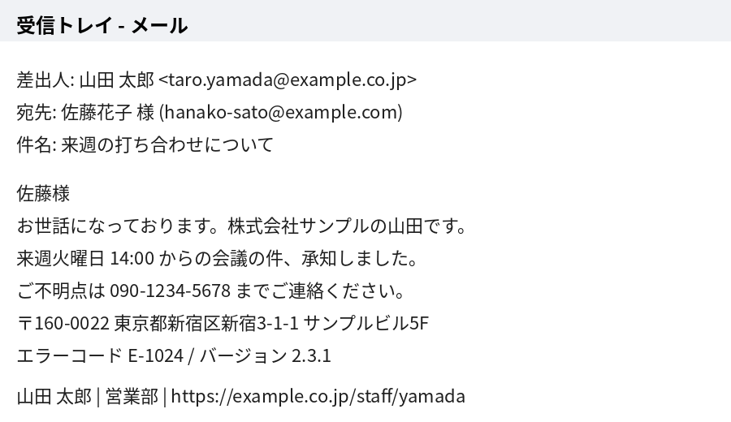
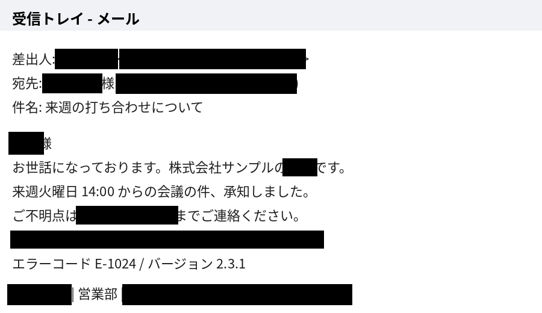

# pii-shot

[English](README.md) | 日本語

スクリーンショットに写った個人情報（氏名・メールアドレス・電話番号・住所など）を、ローカルで自動的に黒塗りする Mac 用コマンドラインツールです。生成AIに画像を渡す前の下処理を想定しています。

処理はすべてお使いの Mac の中で完結し、画像や読み取ったテキストが外部に送られることはありません。モデルはインストール時（手元にない場合は初回実行時）にダウンロードします。以降は `--update-model` を実行したときだけ Hugging Face に接続します。

| 処理前 | 処理後 |
|---|---|
|  |  |

*（例の画像はすべて架空のデータです）*

## セットアップ

```bash
git clone https://github.com/ytkoka/pii-shot.git
cd pii-shot
bash install.sh
```

Python 3.10 以上が必要です。無い場合は `brew install python@3.12` で入れてください。
インストール先は `~/.pii-shot/`（専用の仮想環境）、コマンドは `~/.local/bin/pii-shot` です。OCR モデルと NER モデル（合計約1GB）もこのときに用意するので、以降はオフラインで動きます。

## 使い方

```bash
# 画像を処理（同じフォルダに xxx_masked.png ができる）
pii-shot screenshot.png

# 確認用画像（検出範囲を赤枠表示）も出す ← 最初はこれがおすすめ
pii-shot screenshot.png -p

# クリップボードの画像を処理して、結果をクリップボードに戻す
#   ⌘+Shift+Ctrl+4 で範囲をコピー → pii-shot -c → AIのチャット欄に ⌘+V
pii-shot -c

# 複数ファイルをまとめて、出力先を指定
pii-shot ~/Desktop/*.png -o ~/Desktop/masked
```

### よく使うオプション

| オプション | 内容 |
|---|---|
| `-p`, `--preview` | 検出範囲を赤枠で示した `_preview.png` も出力 |
| `-c`, `--clipboard` | クリップボードの画像を処理し、結果をクリップボードへ |
| `-m 語` | 必ず隠す語（自分の名前、社名、顧客名など）。複数指定可 |
| `-a 語` | 隠さない語（誤検出の除外）。複数指定可 |
| `--orgs` | 会社名などの組織名も隠す |
| `--places` | 地名も隠す |
| `--no-ner` | NERモデルを使わず、正規表現と敬称ルールだけで処理（高速） |
| `--threshold 0.4` | NERのしきい値。下げると人名を拾いやすくなる（誤検出も増える） |
| `--style mosaic` | 黒塗りではなくモザイクにする |
| `--show-ocr` | OCRで読み取った全文を表示（取りこぼしの原因調査用） |
| `--update-model` | NER モデルを Hugging Face の最新リビジョンに更新（画像の指定は不要） |
| `--model-info` | モデル名、ローカルのリビジョン、キャッシュの場所を表示（画像の指定は不要） |

### 必ず隠したい語を登録しておく

`~/.pii-shot-words.txt` に1行1語で書いておくと毎回自動で読み込まれます。

```
# 自分・同僚・取引先の名前など
山田太郎
株式会社サンプル
```

空白の有無は無視して照合します（「山田 太郎」も「山田太郎」も一致）。

### 1つのキーで撮影からマスクまで行う

ショートカット.app で新規ショートカットを作り、「シェルスクリプトを実行」アクションに次を書きます。

```bash
screencapture -i -c || exit 0
~/.local/bin/pii-shot -c -q
osascript -e 'display notification "マスク済み画像をコピーしました" with title "pii-shot"'
```

ショートカットの詳細設定でキーボードショートカットを割り当てると、範囲を選んで撮影するだけでマスク済みの画像がクリップボードに入ります。初回は画面収録の許可を求められます。

## 何を検出するか

| 種類 | 方法 |
|---|---|
| メールアドレス、URL、電話番号、郵便番号、住所（都道府県から始まるもの）、カード番号、IPアドレス | 正規表現 |
| 「〇〇様」「〇〇さん」「〇〇先生」などの敬称付きの名前 | 敬称ルール |
| 「差出人: 〇〇」「宛先: 〇〇」「氏名: 〇〇」「From: 〇〇」などラベルの後の名前 | ラベルルール |
| 文中の人名（任意で組織名・地名） | 日本語NER（tsmatz/xlm-roberta-ner-japanese） |
| 指定した語 | `-m` / `~/.pii-shot-words.txt` |

塗りつぶしは、OCRの位置ずれを考慮して少し大きめ（隠し過ぎる側）にしています。

## モデルの更新

NER モデルは自動では更新されないので、検出結果が知らないうちに変わることはありません。更新するときは次の手順で行います。

1. `pii-shot --update-model` を実行します。更新前後のリビジョン、または更新がなかったことが表示されます。
2. 手元のテスト画像で `pii-shot テスト画像.png -p` を実行し、結果を確認します。

ネットワークに接続できない場合はエラーで終了し、手元のモデルはそのまま使えます。

## 注意

- 自動検出は完全ではありません。送信前に必ず目視で確認してください（`-p` の確認画像が便利です）。
- OCR で読めなかった文字（極端に小さい・薄い・画像内の手書きなど）は検出対象になりません。`--show-ocr` で何が読めているか確認できます。
- 顔写真・アイコン・QRコードなど、文字以外の個人情報は対象外です。
- ユーザー名やハンドル名など、人名に見えない文字列は NER ではほぼ検出されません。`~/.pii-shot-words.txt` に登録してください。
- NER モデルは日本語で学習されています。英語の人名も拾えることはありますが、日本語ほど確実ではありません。
- クリップボード機能（`-c`）は macOS 専用です。それ以外の機能は他の OS でも動く想定ですが、検証は macOS でのみ行っています。

## 使用している OSS

依存パッケージは pip で、モデルはインストール時（手元にない場合は初回実行時）に取得します。このリポジトリには同梱していません。

| 部品 | ライセンス |
|---|---|
| RapidOCR（PaddleOCR モデル） | Apache 2.0 |
| ONNX Runtime | MIT |
| Hugging Face Transformers | Apache 2.0 |
| PyTorch | BSD-3-Clause |
| tsmatz/xlm-roberta-ner-japanese | MIT（学習データは Stockmark 社の Wikipedia NER データセット） |
| Pillow | MIT-CMU (HPND) |

## ライセンス

[MIT](LICENSE)
