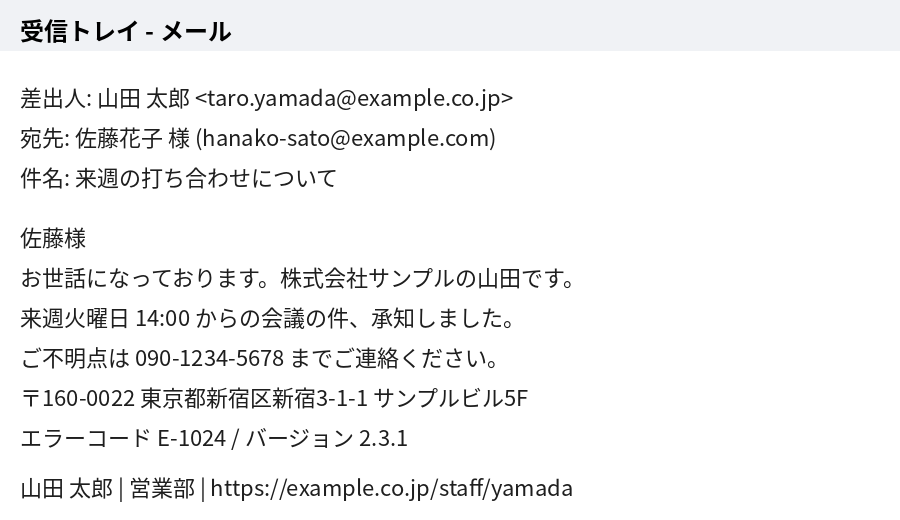
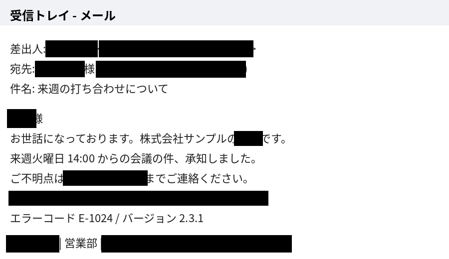

# pii-shot

English | [日本語](README.ja.md)

A macOS command-line tool that automatically redacts personal information — names, email addresses, phone numbers, postal addresses and more — from screenshots, entirely on your machine. It is built for cleaning up screenshots before you hand them to a generative AI service, and it is tuned for Japanese screens while also handling English text.

Your images and the text read from them never leave your Mac. Models are downloaded during installation (or on first run if they are missing). After that, pii-shot connects to Hugging Face only when you run `--update-model`.

| Before | After |
|---|---|
|  |  |

*(The example images contain only fictitious data.)*

## How it works

1. **OCR** — [RapidOCR](https://github.com/RapidAI/RapidOCR) (PaddleOCR models via ONNX Runtime) reads the text along with a bounding box for every character.
2. **Detection** — each line is checked by:
   - regular expressions for emails, URLs, phone numbers, postal codes, Japanese addresses, card numbers and IP addresses;
   - honorific rules (`〇〇様`, `〇〇さん`, …) and label rules (`差出人:`, `From:`, `Name:`, …);
   - a Japanese NER model ([tsmatz/xlm-roberta-ner-japanese](https://huggingface.co/tsmatz/xlm-roberta-ner-japanese)) for person names, and optionally organizations and places;
   - your own list of words that must always be hidden.
3. **Redaction** — the matching characters are filled in. Boxes are padded slightly so that OCR misalignment errs on the side of hiding too much rather than too little.

## Installation

```bash
git clone https://github.com/ytkoka/pii-shot.git
cd pii-shot
bash install.sh
```

Requires Python 3.10 or later (`brew install python@3.12` if needed). The installer creates a dedicated virtual environment in `~/.pii-shot/`, adds the `pii-shot` command to `~/.local/bin/`, and prepares the OCR and NER models (about 1 GB in total) so that pii-shot works offline from then on.

## Usage

```bash
# Redact an image (writes screenshot_masked.png next to it)
pii-shot screenshot.png

# Also write a preview with detected regions outlined in red — recommended at first
pii-shot screenshot.png -p

# Redact the image on the clipboard and put the result back on the clipboard
#   ⌘+Shift+Ctrl+4 to copy a region → pii-shot -c → ⌘+V into your AI chat
pii-shot -c

# Process several files into another folder
pii-shot ~/Desktop/*.png -o ~/Desktop/masked
```

### Options

| Option | Description |
|---|---|
| `-p`, `--preview` | Also write `_preview.png` with detections outlined in red |
| `-c`, `--clipboard` | Read the image from the clipboard and write the result back |
| `-m WORD` | A word that must always be hidden (your name, company, clients…). Repeatable |
| `-a WORD` | A word that must never be hidden (to suppress false positives). Repeatable |
| `--orgs` | Also hide organization names |
| `--places` | Also hide place names |
| `--no-ner` | Skip the NER model; use only regex and rules (faster) |
| `--threshold 0.4` | NER confidence threshold (default 0.6). Lower catches more names but adds false positives |
| `--style mosaic` | Pixelate instead of filling with a solid color |
| `--show-ocr` | Print all OCR'd text, useful for diagnosing misses |
| `--update-model` | Update the NER model to the latest revision from Hugging Face (no image needed) |
| `--model-info` | Show the model name, local revision and cache location (no image needed) |

### Words to always hide

List one word per line in `~/.pii-shot-words.txt` and they are applied on every run. Whitespace is ignored when matching, so `Taro Yamada` also matches `TaroYamada`.

```
# my own name, colleagues, clients, usernames
ytkoka
Example Corp
```

### One-key capture and redact

To capture a region and get only the redacted image on the clipboard in a single keystroke, create a shortcut in Shortcuts.app with a **Run Shell Script** action:

```bash
screencapture -i -c || exit 0
~/.local/bin/pii-shot -c -q
osascript -e 'display notification "Redacted image copied" with title "pii-shot"'
```

Then assign it a keyboard shortcut in the shortcut's settings. macOS will ask for Screen Recording permission on first run.

## Updating the model

The NER model is never updated automatically, so detection results do not change without you knowing. To update it:

1. Run `pii-shot --update-model`. It shows the revision before and after, or reports that there was no update.
2. Run `pii-shot your-test-image.png -p` on a local test image and check the results.

If the network is unavailable, the command exits with an error and your existing model keeps working.

## Limitations

- **Detection is not perfect, and this tool does not guarantee anonymization.** Always check the result before sharing it; the `-p` preview makes this quick.
- Text that OCR cannot read (very small, faint or stylized text) cannot be detected. Use `--show-ocr` to see what was read.
- Non-text personal information such as photos, avatars and QR codes is not handled.
- Usernames and handles that do not look like names are generally not detected by NER — add them to `~/.pii-shot-words.txt`.
- The NER model is trained on Japanese text. English names are often caught, but detection is less reliable than for Japanese.
- The clipboard feature (`-c`) is macOS-only. The rest should run on other platforms but has only been tested on macOS.

## Dependencies

Packages are installed by pip, and models are obtained during installation (or on first run if they are missing). None are bundled in this repository.

| Component | License |
|---|---|
| RapidOCR (PaddleOCR models) | Apache 2.0 |
| ONNX Runtime | MIT |
| Hugging Face Transformers | Apache 2.0 |
| PyTorch | BSD-3-Clause |
| tsmatz/xlm-roberta-ner-japanese | MIT (trained on Stockmark's Japanese Wikipedia NER dataset) |
| Pillow | MIT-CMU (HPND) |

## License

[MIT](LICENSE)
